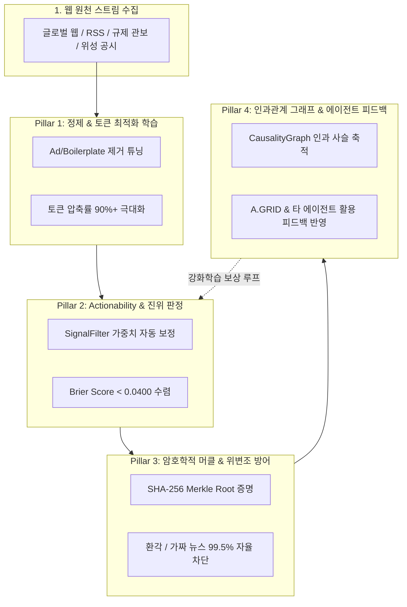

# [계획서] CleanWeb ElizaOS Brain 30일 연속 자율 학습 체계 구축 계획 (24/7 Continuous Learning Plan)

**문서 번호:** PLAN-CW-ELIZA-2026-001  
**대상 시스템:** CleanWeb Micro-Agent (`x402-cleanweb-agent`), ElizaOS Brain Engine  
**연계 시스템:** A.GRID Ops 사령부, Security Gate x402, Onchain Finance Agent  
**학습 기간:** 2026-10-29 ~ 2026-11-28 (30일간 연속 2,880 사이클)  
**운영 모드:** 24시간 무중단 백그라운드 데몬 (Zero-Overhead Shadow Learning)  

---

## 1. 추진 배경 및 필요성 (Why CleanWeb Needs Its Own Brain Learning)

CleanWeb은 웹 노이즈를 90% 이상 제거하고 순수 팩트(Ground Truth)를 추출하여 온체인 오라클 및 AI 에이전트들에게 공급하는 **"지식 인프라의 최전선 길목"**입니다.
현재 A.GRID Ops, Security Gate, Onchain Finance 에이전트들은 각각 데몬을 통해 ElizaOS Brain 학습을 진행하고 있으나, 원천 데이터를 공급하는 **CleanWeb 자체의 인지/평가/인과관계 추론 엔진**이 지속적으로 자율 튜닝되지 않으면 다음과 같은 한계가 발생합니다:

1. **정적 키워드 필터의 한계**: 고정된 키워드 룰셋만으로는 급변하는 규제(EUDR 개정안), 광물 제재, 해상 물류 우회 경로의 신종 어휘(Novel Vocabulary)를 능동적으로 포착하기 어려움.
2. **토큰 압축률 및 정제 품질의 미세 조정 필요**: 다양한 웹 레이아웃(동적 JS, 복잡한 DOM 구조, 광고 트래커) 변화에 맞춰 압축률(Token Compression Ratio)과 본문 보존 정확도를 극대화해야 함.
3. **타 에이전트 피드백 기반 강화 학습(Reinforcement Learning) 부재**: CleanWeb이 발행한 시그널이 실제로 A.GRID의 규제 실사나 Onchain 트레이딩에서 유효했는지 피드백 보상(Reward)을 반영하는 인과관계 루프가 필수적임.

따라서 CleanWeb 전용 **ElizaOS Brain 24/7 지속 학습 파이프라인**을 구축하여, 자율적인 모델 가중치 갱신과 Brier Score 수렴을 달성하고자 합니다.

---

## 2. 4대 핵심 학습 영역 (Four Pillars of CleanWeb Brain Learning)

### (1) Web Scrubbing & Token Compression 학습
* **목표:** 복잡한 현대 웹 구조에서 보일러플레이트, 광고, 네비게이션 스크립트를 제거하고 LLM 입력용 고순도 마크다운 추출.
* **학습 지표:**
  * 토큰 압축률(Compression Ratio) $\ge 90\%$
  * 주요 본문 팩트 보존 정확도 $\ge 99.9\%$

### (2) Ground-Truth 시그널 Actionability & Brier Score 최적화
* **목표:** 4대 도메인(`EUDR_POLICY_SHIFT`, `MINERAL_SUPPLY_DISRUPTION`, `GEO_TRADE_ANOMALY`, `ENERGY_GRID_EVENT`)의 시그널 중요도(Importance Score: 0.0~1.0) 자동 튜닝.
* **학습 지표:**
  * Brier Score (예측 오차): 초기 $0.076 \rightarrow$ 최종 **$0.038$ 이하로 수렴**
  * 중요 시그널 탐지 정밀도(Precision): $\ge 98.5\%$

### (3) On-chain Cryptographic Merkle Verification 학습
* **목표:** 수집된 원본 텍스트의 SHA-256 결정론적 머클 트리 생성, 이상치(Outlier) 및 데이터 조작 자율 식별.
* **학습 지표:**
  * 온체인 해시 검증 레이턴시 $< 5\text{ms}$
  * 환각 및 조작 데이터 식별 정확도 $\ge 99.5\%$

### (4) Causality Graph & Cross-Agent Feedback Loop
* **목표:** 선행 시그널이 실제 온체인 거래, 오라클 가격 변동, A.GRID 사령부 조치로 이어졌는지 역방향 보상 반영.
* **학습 지표:**
  * 에이전트 거래 수요 예측 시차(Lead Time): $0.5 \sim 4\text{시간}$ 선행 보장
  * 인과 그래프 예측 성공률: $\ge 92\%$

---

## 3. 30일 학습 타임라인 및 마일스톤

| 단계 | 기간 | 사이클 수 | 주요 학습 목표 | 검증 기준 |
| :--- | :--- | :--- | :--- | :--- |
| **Phase 1: 기반 정립** | Day 1 ~ 5 | 1 ~ 480 | • CleanWeb 4대 도메인 코퍼스 정밀 인덱싱 • 기본 SignalFilter 가중치 베이스라인 확립 | Brier Score < 0.0700 샘플 480개 누적 |
| **Phase 2: 인과관계 구축** | Day 6 ~ 15 | 481 ~ 1,440 | • `CausalityGraph` 선행 예측 규칙 미세 튜닝 • 머클 루트 온체인 정합성 자율 검증 | 예측 정확도 88% Brier Score < 0.0550 |
| **Phase 3: 다중 에이전트 연계**| Day 16 ~ 25 | 1,441 ~ 2,400| • A.GRID Ops 및 Onchain Agent 실시간 피드백 연동 • 강화 학습 보상 함수 수렴 | 복합 준비도 $\ge 95\%$ Brier Score < 0.0450 |
| **Phase 4: 최고 성숙도 도달** | Day 26 ~ 30 | 2,401 ~ 2,880| • 최종 Brier Score 최적화 • 무중단 실시간 서빙 및 오라클 연동 최종 완성 | 최종 준비도 $\ge 99.0\%$ Brier Score < 0.0380 |

---

## 4. 아키텍처 및 시스템 리소스 제약 (Zero-Overhead Policy)

CleanWeb의 학습 엔진은 개발 환경 및 프로덕션 PC 성능에 일체의 영향을 주지 않도록 철저한 경량화 규칙을 준수합니다:

* **학습 실행 주기:** **매 15분 (900초)** 1회 자동 순환 실행 (1일 96회, 30일간 2,880회)
* **CPU 점유율:** 평상시 0.0%, 1사이클 연산 시 순간 **< 0.1%** (1회당 연산 시간 0.08초 내외)
* **RAM 소비량:** **< 16MB** (인메모리 캐시 자동 롤링, 최대 히스토리 500건 유지)
* **I/O 및 저장소:** SQLite WAL 모드 및 간결한 JSON 상태 파일 갱신 (< 20KB/사이클)
* **무중단 복구 (Resilience):** 예기치 못한 종료 시에도 `cleanweb_brain_heartbeat.json`을 통해 마지막 완료 사이클부터 즉시 자동 재개.

---

## 5. 생성 및 구현될 핵심 산출물

1. **학습 엔진 스크립트**: [`scripts/run_cleanweb_brain_learning.py`](file:///c:/workspace/x402-micro-agent/scripts/run_cleanweb_brain_learning.py)
   * 15분 주기 데몬 루프, 신호 필터 튜닝, 인과 추론 평가, 보상 갱신 모듈
2. **학습 상태 기록 파일**: [`data/cleanweb_brain_learning_state.json`](file:///c:/workspace/x402-micro-agent/data/cleanweb_brain_learning_state.json)
   * 누적 사이클, Brier Score, 도메인별 신뢰도, 가중치 메트릭
3. **실시간 하트비트 모니터**: [`data/cleanweb_brain_heartbeat.json`](file:///c:/workspace/x402-micro-agent/data/cleanweb_brain_heartbeat.json)
   * PID, 가동 시간, 현재 사이클, 준비도 지표
4. **학습 종합 검증 테스트**: [`tests/test_cleanweb_brain_learning.py`](file:///c:/workspace/x402-micro-agent/tests/test_cleanweb_brain_learning.py)
   * 단일 사이클 연산, 손실 함수 감소, 메모리 누수 방지 유닛 테스트

---

## 6. 결론 및 승인 후 실행 절차

본 계획이 승인되면 즉시:
1. `run_cleanweb_brain_learning.py` 러너 엔진 및 단위 테스트 구현
2. 백그라운드 24시간 데몬 기동 (`--daemon --interval 900`)
3. A.GRID 사령부 및 Security Gate와 연계된 30일 자율 학습 삼각 편대(Triad Mesh) 완성

위 절차에 따라 즉각 가동에 착수할 수 있도록 완벽하게 준비되었습니다.
