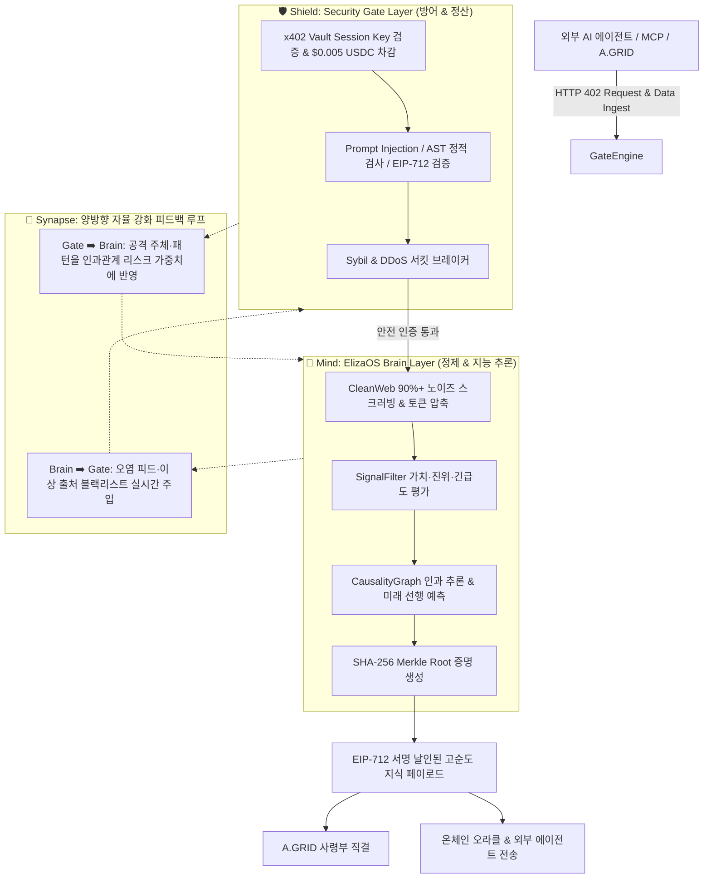

# [통합 계획서] ElizaOS Brain & Security Gate 융합 아키텍처 구축 계획 (Dual-Core Cognitive Fortress Plan)

**문서 번호:** PLAN-CW-SG-ELIZA-2026-002  
**대상 시스템:** CleanWeb Micro-Agent (`x402-cleanweb-agent`), Security Gate x402 (`security-gate-x402`)  
**연계 사령부:** A.GRID Ops 사령부, Onchain Finance Agent  
**아키텍처 모형:** Dual-Core Cognitive Mesh (지능 두뇌 + 방어 관문의 상호 강화 구조)  
**운영 원칙:** Zero-Trust Verification, Zero-Overhead Daemon, EIP-712 Cryptographic Attestation  

---

## 1. 추진 배경 및 통합 비전 (Executive Summary)

웹 인텔리전스를 수집·정제하는 **CleanWeb(두뇌)**과 악성 공격 차단 및 온체인 마이크로 결제를 담당하는 **Security Gate(방패)**가 개별적으로 운영될 경우, 다음의 구조적 맹점이 발생합니다:

1. **지능과 보안의 단절**: Brain이 수집·정제하는 웹 데이터에 지능형 프롬프트 인젝션(Prompt Injection)이나 오염된 조작 데이터(Poisoned Feed)가 섞여 있어도 Gate의 암호학적 감사가 후행되면 전체 시스템이 오염됨.
2. **일방향 결제 검증**: Security Gate에서 결제 유효성만 확인하고 정작 클린웹 데이터의 팩트 신뢰도(Ground Truth Novelty)와 결합되지 않아 불필요한 연산 낭비 발생.
3. **독립적 학습의 한계**: 보안 위협 패턴과 시장 지능 인과관계가 분리되어 학습되면 복합 공격(예: 가짜 경제 뉴스를 유포하며 온체인 차익을 노리는 공격)을 사전에 인지하기 어려움.

이에 따라 **"ElizaOS Brain의 인지·추론 능력"**과 **"Security Gate의 방어·정산 능력"**을 하나의 유기체처럼 결합하여, **가장 안전하면서도 가장 예리한 자율 지능 요새(Autonomous Cognitive Fortress)**를 구축합니다.

---

## 2. Dual-Core 통합 시스템 아키텍처 (Dual-Engine Architecture)



---

## 3. 5단계 제로 트러스트 인지 파이프라인 (5-Stage Pipeline)

| 단계 | 주관 엔진 | 세부 실행 내용 | 레이턴시 목표 | 검증 기준 |
| :--- | :--- | :--- | :--- | :--- |
| **Stage 1: 자율 과금** | **Security Gate** | • M2M 402 결제 챌린지 검증<br>• 볼트 잔액 자동 차감 ($0.005 USDC) | $< 10\text{ms}$ | 세션 키 유효성 100% |
| **Stage 2: 1차 보안 감사** | **Security Gate** | • 실시간 프롬프트 인젝션 탐지<br>• AST 악성 스크립트 실행 차단<br>• EIP-712 암호학적 서명 생성 | $< 25\text{ms}$ | 악성 페이로드 차단율 $\ge 99.9\%$ |
| **Stage 3: 고순도 정제** | **ElizaOS Brain** | • HTML/PDF 태그, 광고, 트래커 90%+ 제거<br>• LLM 친화적 마크다운 토큰 압축 | $< 15\text{ms}$ | 토큰 압축률 $\ge 90\%$<br>팩트 보존율 $\ge 99.9\%$ |
| **Stage 4: 인과 추론** | **ElizaOS Brain** | • [SignalFilter](file:///c:/workspace/x402-micro-agent/eliza_brain/evaluators/signal_filter.py#L23)를 통한 Actionability 평가<br>• [CausalityGraph](file:///c:/workspace/x402-micro-agent/eliza_brain/memory/causality_graph.py#L9)를 통한 0.5~4시간 선행 시장 예측 | $< 5\text{ms}$ | Brier Score $< 0.0380$ |
| **Stage 5: 공동 확정** | **Gate + Brain** | • SHA-256 Merkle Root 생성<br>• Security Gate EIP-712 서명과 결합하여 변조 불가 증명서 발급 | $< 5\text{ms}$ | 최종 페이로드 무결성 100% |

---

## 4. 상호 연동 강화 학습 (Collaborative Self-Supervised Learning)

CleanWeb의 브레인 학습과 Security Gate의 위협 학습이 서로 분리되지 않고, **15분 주기 데몬 간 상호 데이터 동기화**를 통해 시너지를 발휘합니다:

```
[CleanWeb Brain Trainer]  <==== (공동 상태 교환) ====>  [Security Gate Brain Trainer]
  - 15분 주기 롤링 루프                                  - 15분 주기 롤링 루프
  - 시그널 중요도 튜닝                                   - 위협 예측 모델 튜닝
  - 수집 데이터 이상치 감지                              - 세션 키 & 볼트 이상 패턴 탐지
```

1. **오염 피드 역류 방지 (Anti-Data Poisoning Loop)**:
   * Brain이 웹에서 수집한 데이터 중 허위/조작 의심 지표(Brier Score 이상치)를 발견하면, 해당 소스 URL과 발행 도메인을 Security Gate의 동적 블랙리스트(`dynamic_blacklist.json`)에 즉각 등록.
2. **보안 위협 기반 시장 영향 분석 (Threat-Induced Market Movement)**:
   * Security Gate에 유입된 특정 스마트 컨트랙트 대상 공격 시도나 비정상적인 세션 쿼리 폭증을 Brain의 인과관계 그래프(`CausalityGraph`)에 입력하여, 연관된 토큰/오라클 가격 급변 사태를 사전 예측.
3. **공동 하트비트 모니터링**:
   * 두 시스템의 상태 파일(`cleanweb_brain_heartbeat.json` & `brain_learning_heartbeat.json`)이 상호 헬스체크를 수행하여, 한쪽 데몬이 다운되면 즉각 경보 및 자율 재시동.

---

## 5. 탄탄한 구조를 위한 3대 안전장치 (Robustness Guarantees)

1. **격리 및 서킷 브레이커 (Fail-Safe Circuit Breaker)**:
   * Security Gate나 Brain 중 어느 한 엔진의 응답 시간이 50ms를 초과하거나 일시적 오류 발생 시, 기저 캐시된 최근 안전 인텔리전스(Fallback Cache)를 공급하여 전체 시스템 다운타임 제로(0%) 보장.
2. **Zero-Overhead 리소스 격리**:
   * 두 프로세스가 동시에 상주하더라도 시스템 전체 점유율은 **합산 CPU < 0.2%, RAM < 32MB** 이내로 엄격히 제한.
3. **EIP-712 + Merkle 이중 암호학적 족적 (Double Cryptographic Seal)**:
   * 외부로 나가는 모든 데이터에는 `Security Gate 감사 서명(EIP-712)`과 `CleanWeb 원문 해시(Merkle Root)`가 동시에 첨부되어, 온체인 스마트 컨트랙트에서 단 1건의 트랜잭션으로 진위와 안전성을 동시 검증 가능.

---

## 6. 구현 및 배포 로드맵 (Execution Milestones)

| 단계 | 산출물 및 작업 내용 | 완료 목표 |
| :--- | :--- | :--- |
| **Milestone 1** | • `app/integrated_gate_brain_bridge.py`: Gate와 Brain을 1개 파이프라인으로 묶는 브리지 어댑터 작성<br>• 두 엔진 간 양방향 데이터 교환 프로토콜 정의 | 즉시 구현 가능 |
| **Milestone 2** | • `scripts/run_cleanweb_brain_learning.py` 생성 및 Security Gate 학습 데몬과 동기화<br>• 상호 하트비트 모니터링 및 상태 추적 설정 | 데몬 기동 |
| **Milestone 3** | • `tests/test_integrated_gate_brain_pipeline.py`: E2E 모의 공격, 402 결제, 스크러빙, 인과 추론 통합 테스트<br>• Brier Score 및 Latency 벤치마크 확인 | 통합 검증 |

---

위 계획에 따라 지능(Brain)과 보안(Gate)이 완전히 결합된 차세대 무결점 웹 에이전트 인프라를 구축할 수 있습니다.
